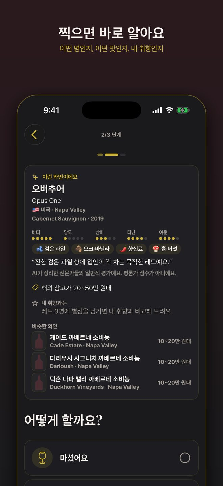
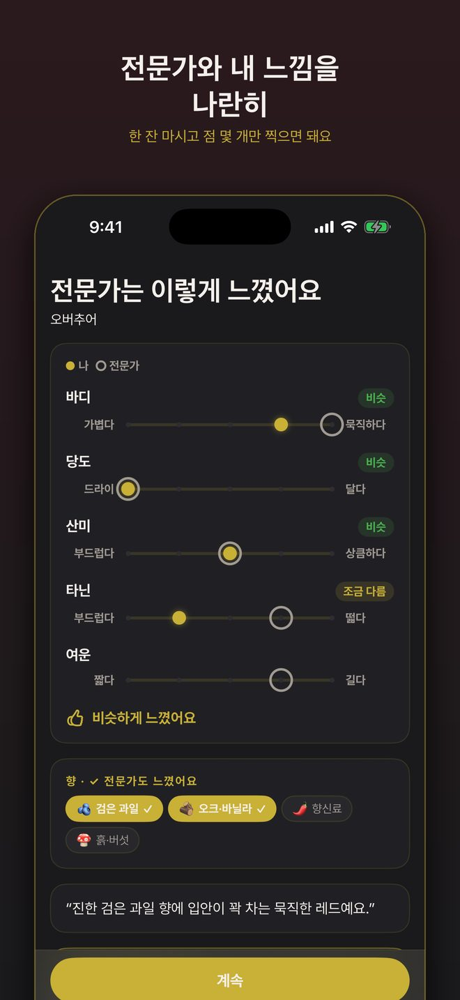
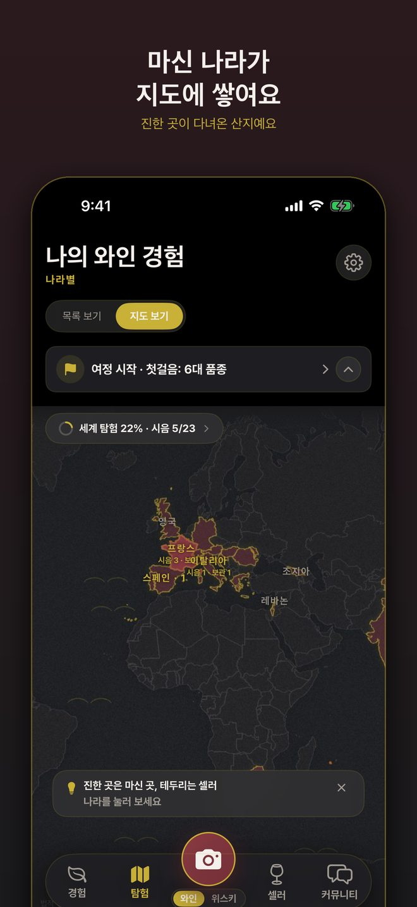
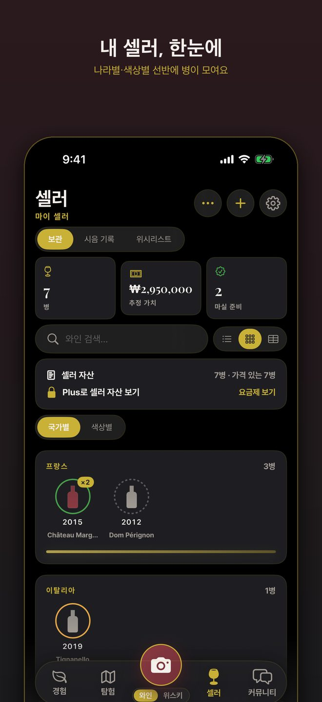
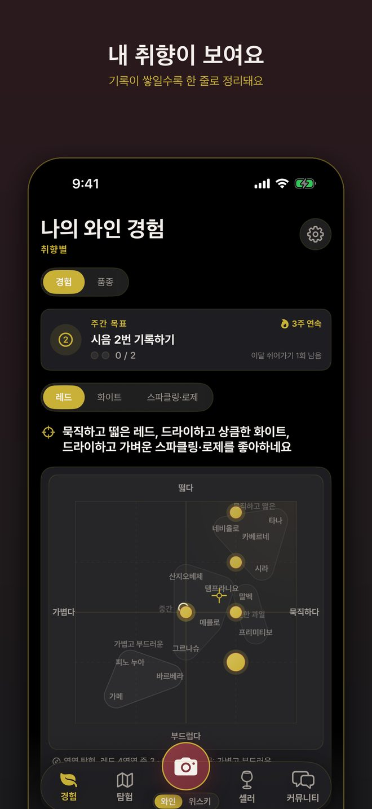
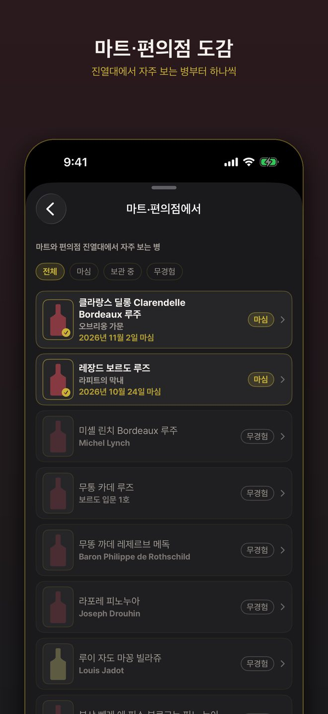
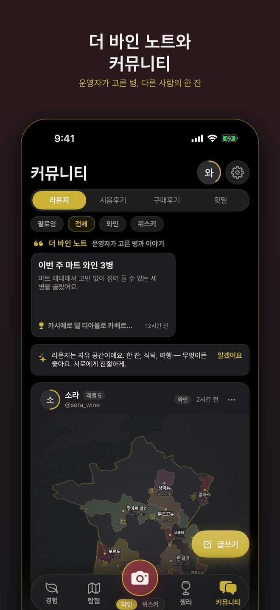
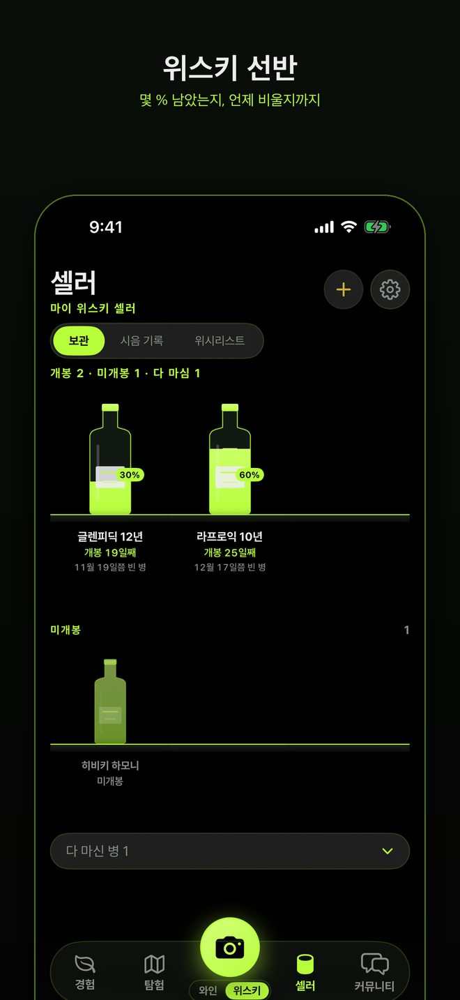
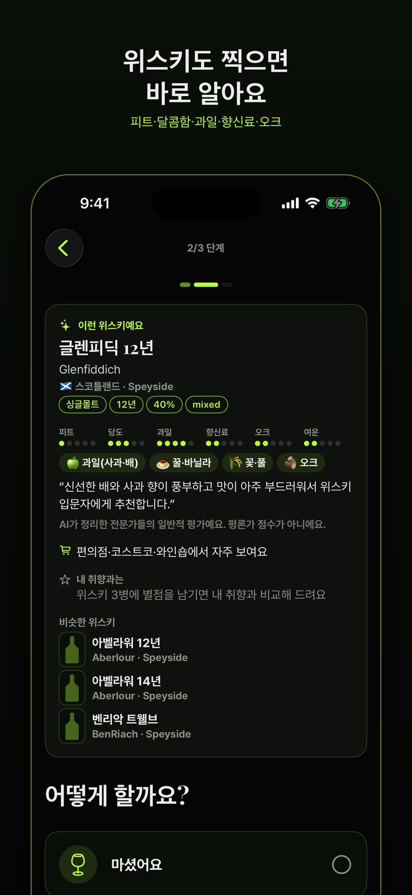
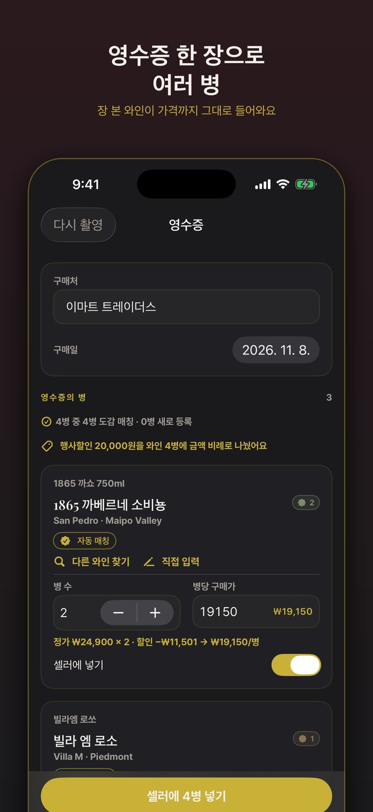

  <h1>The Vine</h1>
  
찍으면 바로 아는 와인·위스키

  App Store 출시 준비 중 · iPhone

  
<h3>찍으면 바로 알아요</h3>
라벨을 찍으면 어떤 병인지, 전문가 기준의 맛 점과 향, 해외 참고가, 비슷한 병까지 한 화면에 보여요.

  
<h3>마셨다면 한 줄만</h3>
점 몇 개만 찍으면 내 느낌과 전문가의 느낌을 나란히 비교해 드려요. 기록이 쌓이면 내 취향이 한 줄로 정리돼요.

  
<h3>지도와 선반이 채워져요</h3>
마신 나라는 세계 지도에 진하게 칠해지고, 셀러는 나라별 선반으로 보여요. 영수증 한 장이면 여러 병이 한 번에 들어와요.

  
<h3>위스키도 똑같이</h3>
피트·달콤함·과일·향신료·오크로 읽고, 선반에서 몇 % 남았는지까지 보여요.

  <figure><figcaption>찍으면 바로 알아요</figcaption></figure>
  <figure><figcaption>전문가와 내 느낌을 나란히</figcaption></figure>
  <figure><figcaption>마신 나라가 지도에 쌓여요</figcaption></figure>
  <figure><figcaption>내 셀러, 한눈에</figcaption></figure>
  <figure><figcaption>내 취향이 보여요</figcaption></figure>
  <figure><figcaption>마트·편의점 도감</figcaption></figure>
  <figure><figcaption>더 바인 노트와 커뮤니티</figcaption></figure>
  <figure><figcaption>위스키 선반</figcaption></figure>
  <figure><figcaption>위스키도 찍으면 바로 알아요</figcaption></figure>
  <figure><figcaption>영수증 한 장으로 여러 병</figcaption></figure>

  
주류 관련 콘텐츠로 성인만 이용할 수 있어요. 가격과 판매처는 참고용이며 앱에서 술을 팔지 않아요. 전문가 맛 점은 AI가 정리한 일반적 평가예요.

  
<a href="support">지원 · Support</a> · <a href="privacy_ko">개인정보처리방침</a> · <a href="terms_ko">이용약관</a> · <a href="privacy_en">Privacy Policy</a> · <a href="terms_en">Terms</a>

  
© 2026 코코아닷컴 (cocoai.kr)

